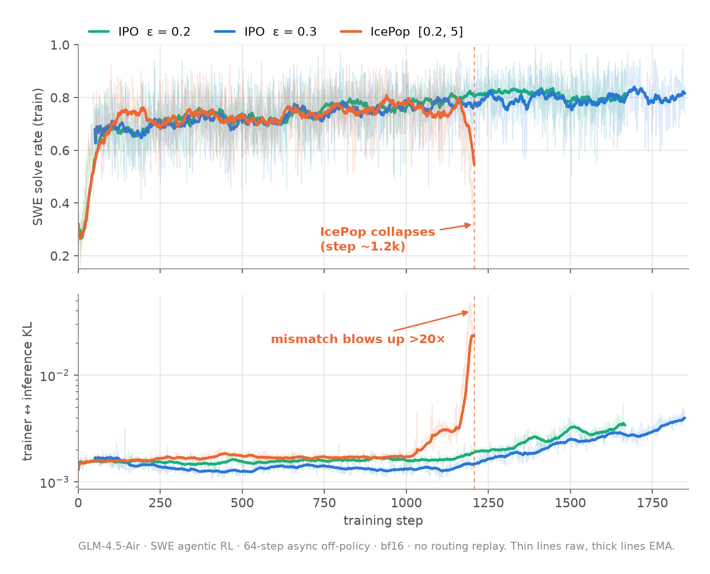
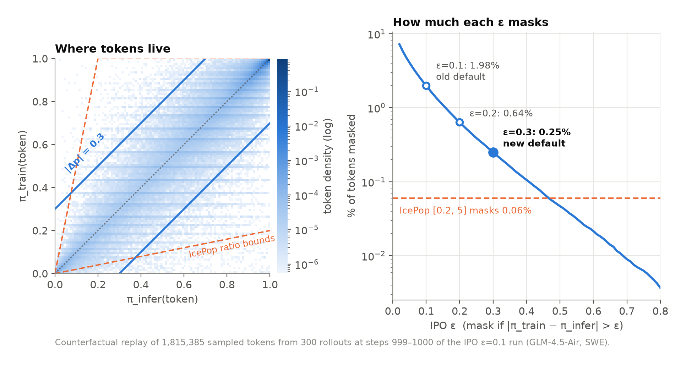

# IPO

IPO (INTELLECT Policy Optimization) is the default RL loss in prime-rl. This page explains why it masks tokens by probability instead of ratio, and shows the ablation behind the default `eps = 0.3`. The loss definition and its knobs are in [Algorithms § IPO Loss](algorithms.md#ipo-loss).

## Table of Contents

- [Masking by Probability, Not Ratio](#masking-by-probability-not-ratio)
- [Ablation: IPO vs IcePop](#ablation-ipo-vs-icepop)
- [Choosing `eps`](#choosing-eps)
- [Reproducing](#reproducing)

## Masking by Probability, Not Ratio

In async RL, the trainer and the inference engine never agree exactly on a token's probability. The usual fix keeps importance sampling but drops the tokens where the two disagree too much. [IcePop](algorithms.md#icepop-loss) measures disagreement as a ratio and masks a token when $\pi_{\text{train}}/\pi_{\text{infer}}$ falls outside a fixed band $[\alpha, \beta]$. IPO masks a token when its absolute probability moved too much:

$$
\left|\pi_{\text{train}}(y_t) - \pi_{\text{infer}}(y_t)\right| > \epsilon
$$

```python
probs_diff = torch.exp(trainer_logprobs) - torch.exp(inference_logprobs)
is_masked = probs_diff.abs() > eps  # double-sided, independent of the advantage sign
```

A ratio treats every token the same regardless of its probability, which behaves badly at both ends:

- A rare token going from 0.01 to 0.06 has a ratio of 6×, so IcePop masks it, although it moved only 0.05 of probability mass.
- A likely token going from 0.90 to 0.20 has a ratio of 0.22, so IcePop keeps it, although it moved 0.70 of probability mass.

Treat the vocabulary as two outcomes, *this token* and *everything else*. Then $|\pi_{\text{train}} - \pi_{\text{infer}}|$ is the total-variation distance between the two engines on that split. The mask is double-sided and has one knob. [KPop](https://ringtech.notion.site/kpop) reached the same diagnosis independently and uses a binary KL instead.

## Ablation: IPO vs IcePop

GLM-4.5-Air on agentic SWE RL, with every arm on the same recipe and only `[trainer.loss]` changing:

| | |
|---|---|
| Model | `zai-org/GLM-4.5-Air` (100B MoE), BF16 training and inference |
| Task | `scaleswe` with the `bash` harness, taskset reward; eval on SWE-Bench Verified |
| Topology | 2 trainer nodes (Muon, CP 4 ulysses), 4 single-node TP=8 inference replicas with expert parallelism |
| Batch | 256 rollouts (16 groups of 16) at 131k context |
| Staleness | up to 64 steps (`max_staleness = 64`), no router replay |
| Algorithm | GRPO with a linear length penalty (output tokens, input tokens, and turns at 0.1) |
| Arms | IcePop with $[\alpha, \beta] = [0.2, 5]$; IPO with `eps = 0.2` and `eps = 0.3` |



For the first 1k steps the arms are indistinguishable. IcePop's trainer–inference KL then creeps up and explodes around step 1.2k, more than 20× its baseline, and the solve rate falls from about 0.8 to about 0.3. Both IPO arms keep the mismatch low through the same window and keep training.

IcePop masks very little before it breaks: at steps 678–679 it masked 72 of 2.16M tokens (0.003%). Under a ratio band, the masked fraction stays tiny while the gap widens, so nothing pushes back once drift starts.

## Choosing `eps`

The first IPO default was `eps = 0.1`. On the run above it masked about 2% of tokens, and by step 1k its entropy had collapsed. To pick a new value without a sweep of full runs, we replayed the trainer and inference probabilities of 1.8M sampled tokens and measured what each `eps` would have masked:



| `eps` | 0.1 | 0.2 | **0.3** | 0.5 | IcePop [0.2, 5] |
|---|---|---|---|---|---|
| tokens masked | 1.98% | 0.64% | **0.25%** | 0.047% | 0.06% |

The IPO band has the same width in probability everywhere. The IcePop cone is very narrow near zero, where it masks rare tokens that barely moved, and very wide near one, where it keeps likely tokens that lost most of their mass. `eps = 0.3` masks only the tail and targets the tokens IcePop lets through. Both 0.2 and 0.3 were stable in full runs; 0.3 kept the highest entropy with the lowest mismatch KL, so it is the default.

## Reproducing

The configs are in [`examples/advanced/glm-4.5-air/ipo-ablation/`](https://github.com/PrimeIntellect-ai/prime-rl/tree/main/examples/advanced/glm-4.5-air/ipo-ablation): a shared `base.toml` and one overlay per loss. See the [GLM-4.5-Air README](https://github.com/PrimeIntellect-ai/prime-rl/tree/main/examples/advanced/glm-4.5-air) for cluster setup.

```bash
uv run rl @ examples/advanced/glm-4.5-air/ipo-ablation/base.toml @ examples/advanced/glm-4.5-air/ipo-ablation/ipo.toml
uv run rl @ examples/advanced/glm-4.5-air/ipo-ablation/base.toml @ examples/advanced/glm-4.5-air/ipo-ablation/ipo.toml --trainer.loss.eps 0.2
uv run rl @ examples/advanced/glm-4.5-air/ipo-ablation/base.toml @ examples/advanced/glm-4.5-air/ipo-ablation/icepop.toml
```

Compare `mismatch_kl/all/mean` and the training solve rate across arms.
