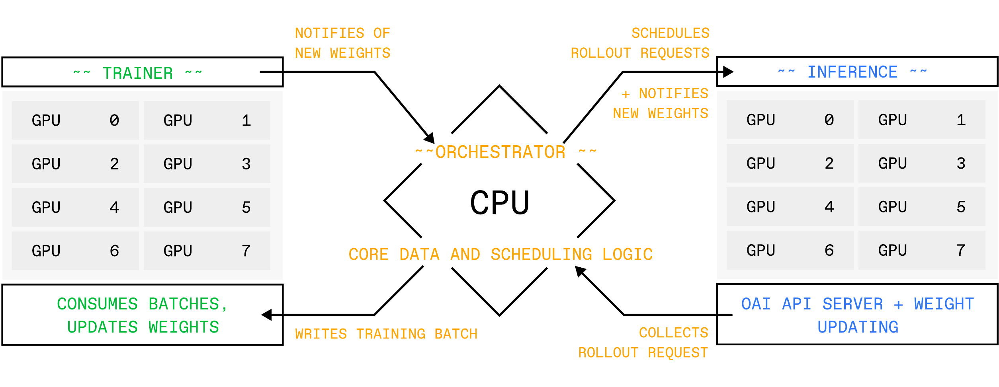

# Overview

`prime-rl` is a framework for large-scale, asynchronous reinforcement learning of large language models. It is designed to be easy to use and hackable, yet capable of training 1T+-parameter MoE models on 1000+ GPU clusters.

## Architecture

A `prime-rl` RL run is three cooperating processes:



- **Inference** — vLLM-backed server (or fleet) holding the current policy. The orchestrator drives rollouts through the token-in `/inference/v1/generate` route via the [`renderers`](https://github.com/PrimeIntellect-ai/renderers) package (OpenAI-compatible chat/completions routes are also exposed for external clients). We are trying to stay up-to-date with the latest vLLM features, you can read more about the supported features and deployment options in the dedicated [inference documentation](inference.md).
- **Orchestrator** — Lightweight CPU process that owns the data plane across many [`verifiers`](https://github.com/PrimeIntellect-ai/verifiers) training and eval environments. Each env runs in an isolated subprocess with a variable-size pool of env workers for scalability. The orchestrator drives multi-turn rollouts against the inference fleet (tool use, browsers, sandboxes, long horizons) without re-tokenizing across turns, computes advantages, batches the rollouts for training, and relays new weights from trainer to inference. It never holds a rollout's tokens: each env worker keeps the training samples of the rollouts it ran, the orchestrator ships them by reference, and every trainer rank plans the step's micro batches from those references and fetches its own.
- **Trainer** — FSDP2 process group that consumes packed rollouts and steps the optimizer. We ship optimized custom modeling code for many MoE / dense / VLM families that unlocks advanced trainer parallelism — expert parallelism (EP, with DeepEP kernels) and context parallelism (CP) for long-sequence training — plus selective activation checkpointing, FP8 training on Hopper+, and LoRA. You can read more in the dedicated [training documentation](training.md).

The three processes communicate through transports — the trainer↔orchestrator rollout link uses ZMQ (the orchestrator offers each step as soon as it has it, so trainer ranks plan it while they train the step before, but counts a step as sent only once every rank requests it, so a rank holds at most the step it trains and the next one), and weight broadcast goes through the shared filesystem by default, or through [ModelExpress](model-express.md) for in-memory transfer over RDMA. See [Scaling](scaling.md) for the deployment options.

## Installation

```bash
curl -sSL https://raw.githubusercontent.com/PrimeIntellect-ai/prime-rl/main/scripts/install.sh | bash
```

The script clones the repo, initializes the [`verifiers`](https://github.com/PrimeIntellect-ai/verifiers) / [`renderers`](https://github.com/PrimeIntellect-ai/renderers) / [`prime-envs`](https://github.com/PrimeIntellect-ai/prime-envs) submodules, installs `uv`, and runs `uv sync --all-extras`. For manual setup, or troubleshooting, see the [README](https://github.com/PrimeIntellect-ai/prime-rl#setup).

You need at least one NVIDIA GPU (RTX 3090/4090/5090, A100, H100, H200, or B200). Single-GPU runs are supported for debugging; production RL is typically 1× inference node + 1+ trainer nodes.

## Quick Run

Train an SFT-warmed `Qwen3-0.6B` on the `reverse-text` task — the env is bundled with the [`verifiers`](https://github.com/PrimeIntellect-ai/verifiers) submodule so no separate install is needed. This config ships in the repo and runs on two GPUs (one for inference, one for the trainer):

```bash
uv run rl @ examples/basic/reverse-text/rl.toml
```

The `rl` entrypoint reads `examples/basic/reverse-text/rl.toml`, splits it into per-process sub-configs, picks GPU 0 for inference and GPU 1 for the trainer, launches all three processes, and tees their stdout into the run directory at `outputs/<run_name>/logs/latest/{trainer,orchestrator,inference}.log` (`run.name` auto-generates as `<envs>--<model>--<short-id>`; pass `--run.name <name>` for a predictable path). Within a minute the trainer should log `step 1` and a reward sample; after 20 steps the run completes with a final DCP checkpoint at `outputs/<run_name>/checkpoints/step_20`.

## Documentation

- **[Configuration](configuration.md)** — TOML composition, CLI overrides, dry-run.
- **[Training](training.md)** — Launch and observe RL and SFT runs.
- **[Inference](inference.md)** — vLLM-backed server (or fleet) holding the current policy.
- **[Scaling](scaling.md)** — Single-GPU through multi-node clusters via FSDP / EP / CP and SLURM.
- **[Algorithms](algorithms.md)** — Async semantics, loss / advantage / filter plugins, trajectory merging.
- **[Advanced](advanced.md)** — Custom modeling, multimodal, LoRA, P/D inference.
- **[Development](development.md)** — Test suite, pre-commit hooks, adding a new model.
